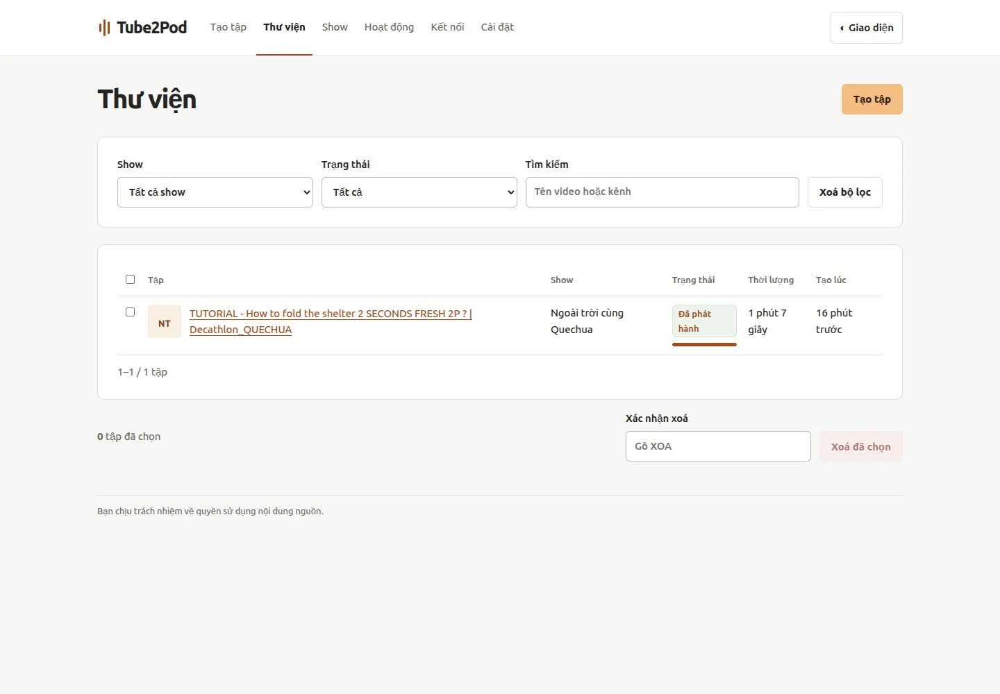
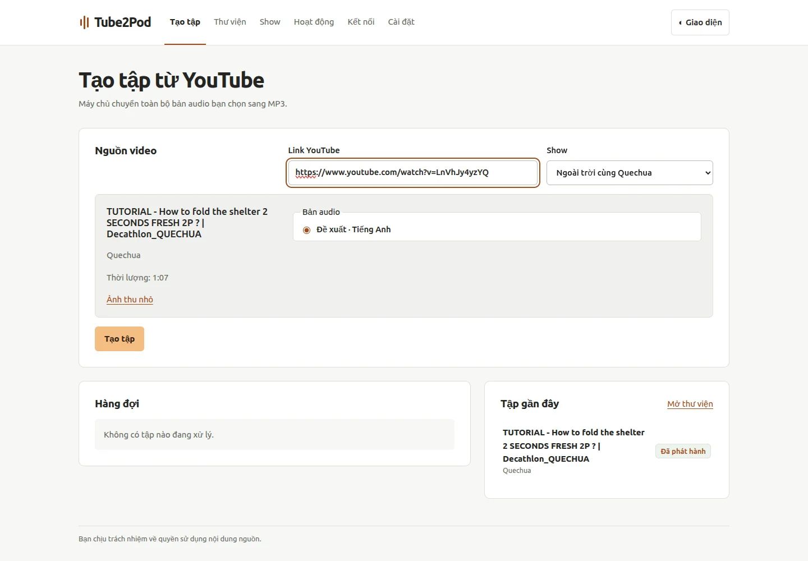
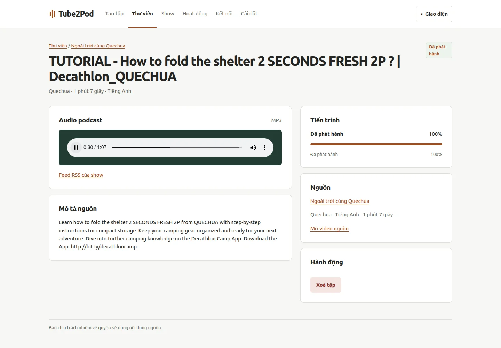
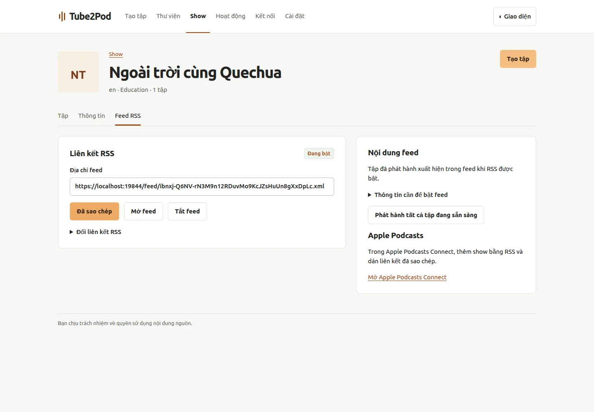

# 

**Tiếng Việt (mặc định)** · [English](README.en.md) · [简体中文](README.zh-CN.md)

Biến audio từ video YouTube thành podcast RSS, lưu và phục vụ từ máy của bạn.
Quản trị bằng trình duyệt; người nghe đăng ký feed trong ứng dụng podcast.
Không cần Tailscale hay máy chủ relay để chia sẻ trực tiếp từ nhà.

[Tổng quan](#overview) · [Demo](#demo) · [Yêu cầu](#requirements) · [Cài đặt](#installation) · [Sử dụng](#usage) · [HTTPS](#https) · [Vận hành](#operations) · [Khắc phục lỗi](#troubleshooting) · [Phát triển](#development)

<a id="overview"></a>
## Tổng quan

### Các tính năng

- Chọn bản audio nguồn bằng `yt-dlp`, chuyển toàn bộ sang MP3 bằng `ffmpeg`, đo thời lượng bằng `ffprobe`.
- Quản lý show, tập, hàng đợi, ảnh bìa và feed RSS riêng cho từng show.
- Nghe thử, phát hành, lọc thư viện; giao diện sáng/tối/theo hệ thống.
- Ghép app điện thoại trong LAN bằng QR một lần; quản trị chỉ ở máy nhà.
- HTTPS trực tiếp qua Caddy và NAT; bộ cài tải công cụ media, Caddy cài riêng.

```text
YouTube → yt-dlp → ffmpeg → MP3 + SQLite trên máy nhà
Người nghe → HTTPS/tên miền → router NAT → Caddy → public :8401
Chủ máy  → http://localhost:8402 → web quản trị
```

### Nền tảng và trạng thái kiểm chứng

| Nền tảng | Gói mục tiêu | Đã kiểm chứng |
| --- | --- | --- |
| Ubuntu Desktop 24.04 x64 | `tube2pod-x86_64-unknown-linux-gnu.deb` | GDebi trên container Ubuntu sạch: cài, tải công cụ, nguồn thật/RSS, mở offline sau cài lại |
| Windows x64 | `tube2pod-x86_64-pc-windows-msvc.exe` | CI native: tải công cụ, RSS/MP3 fixture và cài lại đạt |
| macOS Apple Silicon | `tube2pod-aarch64-apple-darwin.pkg` | CI native: tải công cụ, RSS/MP3 fixture và cài lại đạt |
| macOS Intel | `tube2pod-x86_64-apple-darwin.pkg` | CI native: tải công cụ, RSS/MP3 fixture và cài lại đạt |

Đã kiểm tra HTTPS local, RSS/ảnh/MP3, HEAD/Range và cách ly quản trị. Chưa kiểm chứng DNS/NAT/phát podcast từ mạng ngoài nhà.

[Kiểm thử bộ cài](https://github.com/nguyentrichanhung/Tube2Pod/actions/runs/45599981342) đã đạt trên cả bốn nền tảng. Mỗi máy đều tải công cụ, chuyển tệp âm thanh mẫu thành MP3 và đọc lại được RSS cùng MP3 sau khi gỡ rồi cài lại. Trên Ubuntu cục bộ, bản 0.1.0 cũng đã phát hành được tập dài 67 giây từ video YouTube mẫu. Khi thử cùng video trên GitHub Actions, YouTube yêu cầu yt-dlp đăng nhập để xác nhận người dùng ở bước xem trước. [Nhật ký chẩn đoán](https://github.com/nguyentrichanhung/Tube2Pod/actions/runs/45616026027/job/139211516893)

<a id="demo"></a>
## Bản trình diễn



Ảnh chụp từ ứng dụng thật trên dữ liệu thử riêng ngày **25/11/2026**, không phải mockup. Tập minh họa dùng [video Quechua do người dùng cung cấp](https://www.youtube.com/watch?v=LnVhJy4yzYQ), đã được pipeline thật xử lý và phát hành: MP3 **67,05 giây**, **1.073.709 byte**.

Trong Chrome, đã xem trước nguồn YouTube thật, sửa thông tin show, mở Thư viện, phát tập, tua tới giây 30 và mở trang Feed RSS. Trình phát tiếp tục chạy sau khi tua, không báo lỗi media. URL `localhost:19844` trong ảnh là cấu hình thử local, không phải feed công khai để người đọc đăng ký.

| Màn hình | Thao tác |
| --- | --- |
| Thư viện | Lọc theo show/trạng thái, mở tập đã phát hành |
| Chi tiết tập | Phát MP3 và tua bằng thanh thời gian |
| Feed RSS | Xem trạng thái feed, sao chép URL và điều kiện phát hành |

<details>
<summary>Xem preview, trình phát và Feed RSS</summary>







</details>

<a id="requirements"></a>
## Yêu cầu

Bộ cài ứng dụng tự tải công cụ media; hướng dẫn cài thủ công dưới đây chỉ áp dụng cho gói portable.

| Thành phần | Khi nào cần | Nguồn cài đặt |
| --- | --- | --- |
| Tube2Pod native | Luôn cần | Build từ source hoặc artifact của workflow thành công |
| `yt-dlp` standalone | Xem trước/tải audio | [Bản chính thức](https://github.com/yt-dlp/yt-dlp#release-files) |
| `ffmpeg` và `ffprobe` | Chuyển và kiểm tra MP3 | [FFmpeg Downloads](https://ffmpeg.org/download.html) |
| Caddy | Chia sẻ HTTPS ra Internet | [Caddy Install](https://caddyserver.com/docs/install) |
| IP public, quyền NAT/router | Truy cập từ ngoài nhà | TCP 80/443 tới máy chạy Caddy |

Dùng `yt-dlp_linux` cho Linux x64, `yt-dlp_macos` cho macOS, `yt-dlp.exe` cho Windows. Bản `pip install --user` có thể mất module Python vì ứng dụng chạy yt-dlp với HOME/cache riêng; ưu tiên standalone. Máy cần đủ chỗ lưu audio và luôn hoạt động khi người nghe truy cập. Không cần Rust nếu đã có gói native phù hợp.

<a id="installation"></a>
## Cài đặt

1. Trong [Releases](https://github.com/nguyentrichanhung/Tube2Pod/releases), chọn gói ZIP đúng máy: **Windows x64**, **Ubuntu 24.04 x64**, **Mac Apple Silicon** hoặc **Mac Intel**. Trên Mac, xem loại chip trong menu Apple → **Giới thiệu về máy Mac này**.
2. Giải nén gói. Bên trong có **bộ cài** và video tiếng Việt **Huong-dan-Tube2Pod.mp4** quay trên Ubuntu. Mở bộ cài rồi mở **Tube2Pod** từ danh sách ứng dụng.
3. Kết nối Internet và bấm **Cài đặt** để tải các công cụ lần đầu. Khi màn hình báo sẵn sàng, bấm **Mở Tube2Pod**.

Bản 0.1.0 hiện ở dạng nháp, chỉ người có quyền xem bản nháp mới tải được gói kèm video. Người dùng đã đăng nhập GitHub cũng có thể tải bộ cài từ [Actions](https://github.com/nguyentrichanhung/Tube2Pod/actions/runs/45599981342).

Các gói Windows và macOS chưa có chữ ký nhà phát hành. [Hướng dẫn cài thủ công và cấu hình gói portable](docs/guide.md#installation)

<a id="usage"></a>
## Tạo và chia sẻ podcast

1. Mở **Cài đặt**: nhập tên/email chủ sở hữu và giới hạn thời lượng nguồn.
2. Mở **Show**: tạo show, điền mô tả/ngôn ngữ/danh mục và kiểm tra ảnh bìa.
3. Mở **Tạo tập**: dán URL YouTube có quyền sử dụng, chọn show, chờ preview và chọn bản audio.
4. Nhấn **Tạo tập**, theo dõi hàng đợi; khi **Sẵn sàng**, mở tập để nghe thử.
5. Vào show → **Feed RSS**, hoàn tất checklist, bật feed và phát hành các tập sẵn sàng. Cần public origin hợp lệ để bật RSS.
6. Sao chép **toàn bộ URL feed** và thêm vào app podcast. Nếu gửi lên Apple Podcasts, dùng [Apple Podcasts Connect](https://podcastsconnect.apple.com/).

Ghép điện thoại trong cùng Wi-Fi: **Kết nối → Tạo mã ghép cặp**, quét bằng app Tube2Pod; tạo QR mới cho mỗi thiết bị. QR dùng một lần/có hạn; thu hồi thiết bị ở cùng trang. Xem [app mobile](apps/mobile/README.md).

<a id="https"></a>
## HTTPS tại nhà và tên miền miễn phí

1. Xem username bằng `whoami`; trên Windows dùng phần sau dấu `\`. Đăng nhập [DuckDNS](https://www.duckdns.org/) và tạo `<username>.duckdns.org` nếu hợp lệ/còn trống. Đây là gợi ý tên, không tự đăng ký.
2. Trỏ hostname tới IP public của nhà. Khi IP đổi, cập nhật qua phương thức bạn quản lý theo [DuckDNS API](https://www.duckdns.org/spec.jsp). Tube2Pod không tự cập nhật DNS.
3. Đặt `PUBLIC_BASE_URL=https://hostname-cua-ban.duckdns.org` rồi restart server.
4. Copy `Caddyfile.example` thành `Caddyfile` (trong source: `deploy/Caddyfile.example`), thay hostname:

```caddyfile
hostname-cua-ban.duckdns.org {
    reverse_proxy 127.0.0.1:8401
}
```

5. NAT TCP **80/443** tới máy chạy Caddy, cho phép hai cổng này qua firewall. Terminal thứ hai:

```sh
caddy run --config Caddyfile --adapter caddyfile
```

Với DNS/cổng đúng, Caddy [cấp và gia hạn chứng chỉ](https://caddyserver.com/docs/automatic-https). Giữ dữ liệu Caddy bền vững. DNS/chứng chỉ là dịch vụ hạ tầng; luồng audio đi thẳng về máy nhà, không qua relay.

| Cổng mặc định | Mục đích | Phạm vi |
| --- | --- | --- |
| 8400 | Admin cũ | Loopback |
| 8401 | RSS/audio/cover/health | Loopback; chỉ Caddy proxy tới đây |
| 8402 | Owner UI | Loopback; quản trị trên máy nhà |
| 8403 | Ghép/kết nối app | LAN |
| 80/443 | Caddy/HTTPS | NAT từ Internet |

**Không NAT 8400–8403 ra Internet.** Dùng 4G/5G kiểm tra feed, ảnh, phát và tua MP3. Wi-Fi nhà có thể thiếu NAT loopback; kiểm tra localhost không chứng minh truy cập Internet. Xem [hướng dẫn HTTPS chi tiết](deploy/direct-https.md).

<a id="operations"></a>
## Vận hành, backup và nâng cấp

### Vị trí dữ liệu

| Cách chạy | DATA_DIR mặc định |
| --- | --- |
| Portable Windows | `%LOCALAPPDATA%\Tube2Pod` |
| Portable macOS | `~/Library/Application Support/Tube2Pod` |
| Portable Linux | `$XDG_DATA_HOME/tube2pod` hoặc `~/.local/share/tube2pod` |
| Linux systemd | `/var/lib/tube2pod` |

DATA_DIR đã cấu hình luôn được giữ. Mặc định portable chỉ áp dụng với `--config`; chạy không có cờ này giữ chế độ biến môi trường cũ.

### Linux systemd

Cài media tools system-wide: unit dùng `ProtectHome=true`, nên công cụ dưới `/home` không truy cập được. Cấu hình mẫu dùng yt-dlp tại `/usr/local/bin/yt-dlp`, ffmpeg/ffprobe tại `/usr/bin`; đặt binary đúng chỗ hoặc sửa đường dẫn trong `/etc/tube2pod/tube2pod.env` rồi chạy lại installer.

```sh
# Trong gói Linux đã giải nén; cài/khởi động dịch vụ
sudo deploy/install-linux-x86_64.sh ./tube2pod
sudo systemctl status tube2pod
sudo journalctl -u tube2pod -f
# Dừng / khởi động lại
sudo systemctl stop tube2pod
sudo systemctl restart tube2pod
```

Installer tạo tài khoản dịch vụ, giữ env/data hiện có, thay binary/unit và restart. Caddy vẫn được quản lý riêng.

### Backup và migration

Dừng server và sao lưu **toàn bộ DATA_DIR** cùng file cấu hình; nếu đang chạy, dùng SQLite online backup phù hợp. Giải nén phiên bản mới vào thư mục khác, dùng lại cấu hình/data; không ghi đè env, đổi token hay public URL ngoài ý muốn.

**Nâng từ pipeline cũ:** lần chạy đầu xóa các tập cũ chưa có lựa chọn audio ở trạng thái `queued/running/review` cùng file liên quan, kể cả audio đã phát hành đang được đọc lại. Các tập khác giữ audio/transcript/summary/URL. Thử nâng trên bản sao trước; cleanup gián đoạn có thể tiếp tục khi restart.

Cleanup chạy lúc khởi động và mỗi 24 giờ:

- Audio cũ/không còn được tham chiếu: mặc định 7 ngày (`retention_old_audio_days`); giữ audio hiện tại của mọi tập. File phiên bản gắn với tập tính theo `updated_at`, file mồ côi theo mtime.
- Thư mục tạm của tập `failed/cancelled/ready/published` và UUID mồ côi: mặc định 24 giờ (`retention_tmp_hours`), theo mtime; bỏ qua queued/running, `tmp/yt-dlp` và thư mục không phải UUID. Hai giá trị retention được giới hạn tối thiểu 1 ngày/giờ.
- Transcript chuẩn không bị retention xóa. Backup database tự động trong `backups/` không chứa audio và không thay bản sao toàn bộ dữ liệu.

Đổi token vô hiệu URL cũ ngay lập tức. Đổi hostname có thể làm hỏng đăng ký hiện có; chỉ redirect khi còn kiểm soát địa chỉ cũ. Triển khai relay cũ vẫn có [hướng dẫn riêng](deploy/relay.md).

<details>
<summary>Tailscale tùy chọn cho triển khai đã dùng từ trước</summary>

```sh
sudo tailscale serve --bg --https=443 http://127.0.0.1:8400
sudo tailscale funnel --bg --https=8443 http://127.0.0.1:8401
```

Admin chỉ trong tailnet; public qua Funnel 8443. PUBLIC_BASE_URL phải khớp origin Funnel, gồm `:8443`, không có dấu `/` cuối. Không expose admin bằng Funnel. Cài mới theo hướng dẫn Caddy ở trên không cần Tailscale.

</details>

<a id="troubleshooting"></a>
## Khắc phục lỗi

| Hiện tượng | Kiểm tra |
| --- | --- |
| Không tìm thấy media tool / thiếu Python module | Dùng standalone và đường dẫn tuyệt đối; kiểm tra quyền chạy và lệnh version |
| ffmpeg không thấy file trong thư mục tạm | Kiểm tra quyền/sandbox của bản cài; bản Snap có thể không thấy `/tmp` của ứng dụng |
| Preview/tải YouTube thất bại | Kiểm tra URL, mạng và yt-dlp mới nhất; nguồn ngoài có thể timeout/đổi khả dụng. Kiểm tra log terminal, không coi preview cũ là bảo đảm lần tải sau |
| Cổng đang được dùng | Dừng đúng tiến trình xung đột hoặc đổi BIND tương ứng; public đổi cổng thì sửa upstream Caddy |
| Không bật được feed | Hoàn tất checklist show/chủ sở hữu/bìa và PUBLIC_BASE_URL |
| Feed không mở ngoài nhà | Kiểm tra DNS, IP public, NAT 80/443, firewall và cả hai tiến trình; thử mạng ngoài |
| Không ghép được điện thoại | Cùng LAN, cho phép 8403 trong mạng nội bộ, tạo QR mới nếu đã dùng/hết hạn |

<a id="development"></a>
## Phát triển và kiểm thử

Dùng Rust stable hiện hành và toolchain native (Windows: MSVC/C++ Build Tools; macOS: Xcode Command Line Tools; Linux: C compiler/linker). Cargo.toml khai báo Rust 1.85 tối thiểu; chưa xác minh toàn bộ lockfile trên phiên bản tối thiểu này.

```sh
cargo build --release --locked --bin tube2pod
cargo test --locked --all-targets
cargo fmt --all -- --check
# Cần ffmpeg/ffprobe thực trong PATH hoặc biến *_PATH
cargo test --locked --bin tube2pod real_media_conversion_with_spaces -- --ignored
```

Từ source checkout, copy `deploy/portable.env.example` thành file cấu hình riêng, rồi chạy `cargo run --locked --bin tube2pod -- --config /đường/dẫn/tube2pod.env`. Lệnh build tạo binary, chưa phải gói giải nén:

```sh
# Chạy trên Linux x64; macOS dùng target đúng kiến trúc native
./deploy/package.sh x86_64-unknown-linux-gnu target/release/tube2pod dist
```

```powershell
# Chạy trên Windows x64
.\deploy\package.ps1 -Target x86_64-pc-windows-msvc -Binary target/release/tube2pod.exe -OutDir dist
```

Workflow kiểm thử trên bốn nền tảng, bao gồm cài đặt, tải công cụ và đọc lại RSS/MP3 sau khi cài lại. Khi chạy thủ công, nhập một video YouTube có quyền sử dụng vào `youtube_url` để kiểm tra thêm luồng từ xem trước đến phát hành.

## Đóng góp

Khi báo lỗi, ghi OS/kiến trúc, cách chạy, phiên bản công cụ, bước tái hiện và log đã bỏ bí mật. Không đưa token ghép thiết bị, khóa hoặc dữ liệu riêng vào issue. Với sửa code, chạy kiểm tra liên quan và mô tả kết quả trong PR.

## Giấy phép

Mã nguồn dùng [Apache License 2.0](LICENSE). Chỉ tải và phân phối nội dung bạn có quyền sử dụng.
