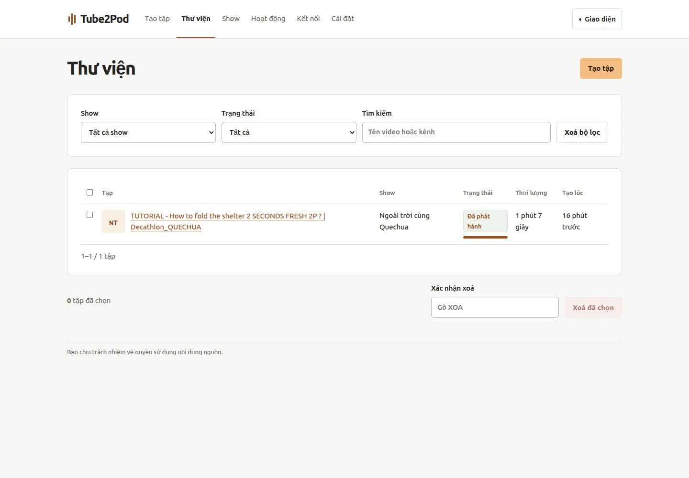
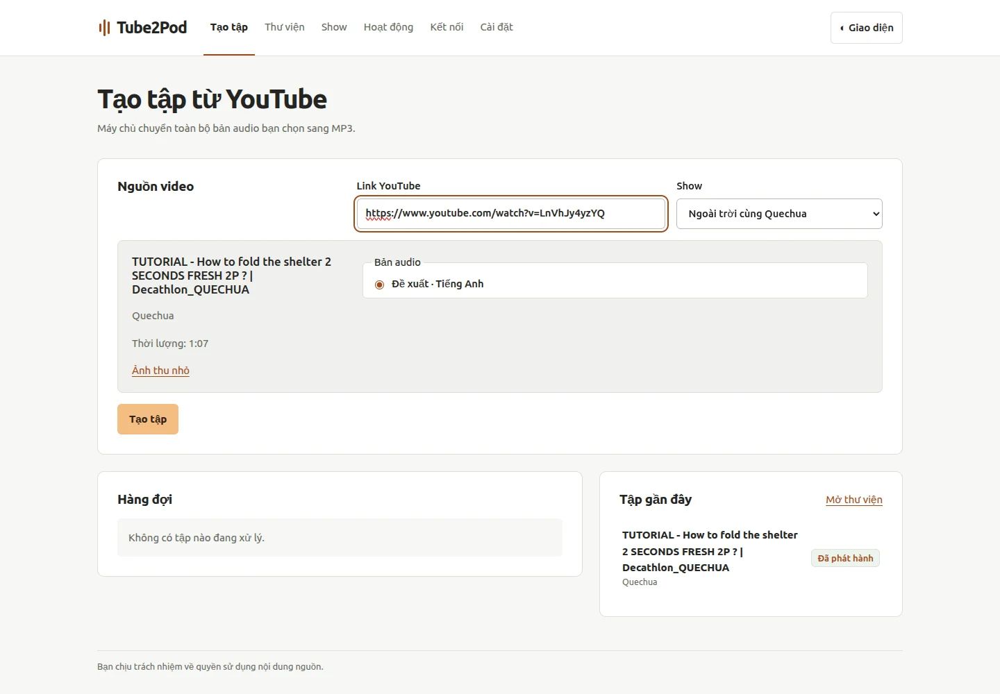
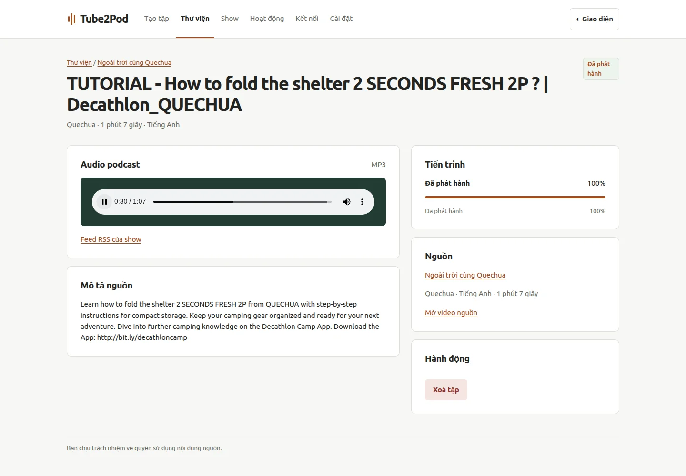
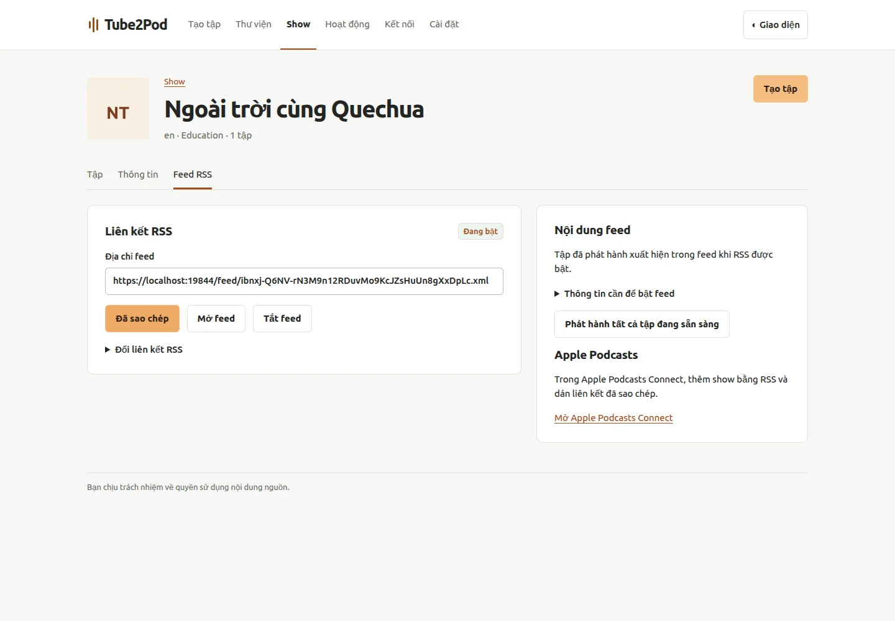

# Tube2Pod

[Tiếng Việt（默认）](README.md) · [English](README.en.md) · **简体中文**

将 YouTube 视频的源音频转换为 RSS 播客，在自己的电脑上存储和提供服务。
通过浏览器管理节目，听众使用播客应用订阅。
从家中直接发布无需 Omnivoice、Tailscale 或中继服务器。



[概览](#overview) · [演示](#demo) · [环境要求](#requirements) · [安装](#installation) · [使用](#usage) · [HTTPS](#https) · [运维](#operations) · [故障排查](#troubleshooting) · [开发](#development)

<a id="overview"></a>
## 概览

- 用 `yt-dlp` 选择源音轨，用 `ffmpeg` 将完整音轨转成 MP3，用 `ffprobe` 检查时长。
- 管理节目、单集、任务队列和封面；每个节目有独立的 RSS feed。
- 试听、发布和筛选音频库；支持浅色、深色及跟随系统主题。
- 通过一次性二维码在局域网内配对手机应用；管理入口保留在家中电脑上。
- 通过 Caddy 和路由器 NAT 直接提供 HTTPS；媒体工具和 Caddy 需要单独安装。

```text
YouTube → yt-dlp → ffmpeg → 家中电脑上的 MP3 + SQLite
听众 → HTTPS/域名 → 路由器 NAT → Caddy → public :8401
所有者 → http://localhost:8402 → 管理网站
```

### 平台与验证状态

| 平台 | 目标安装包 | 已验证情况 |
| --- | --- | --- |
| Linux x64 | `tube2pod-x86_64-unknown-linux-gnu.tar.gz` | Ubuntu 22.04.5：构建、启动、真实来源、发布和重启 |
| Windows x64 | `tube2pod-x86_64-pc-windows-msvc.zip` | 已准备 workflow；尚未在原生系统运行 |
| macOS Apple Silicon | `tube2pod-aarch64-apple-darwin.tar.gz` | 已准备 workflow；尚未在原生系统运行 |
| macOS Intel | `tube2pod-x86_64-apple-darwin.tar.gz` | 已准备 workflow；尚未在原生系统运行 |

已检查本地 HTTPS、RSS/封面/MP3、HEAD/Range 和管理接口隔离。真实 DNS/NAT 及外网播客播放尚未验证。表中的文件名不代表已有公开发行包可供下载。

### 安装桌面应用

工作流成功后，从对应的 Actions 页面下载适合电脑的安装程序：Windows x64 `tube2pod-x86_64-pc-windows-msvc.exe`、Ubuntu Desktop x64 `tube2pod-x86_64-unknown-linux-gnu.deb`、macOS Apple Silicon `tube2pod-aarch64-apple-darwin.pkg` 或 macOS Intel `tube2pod-x86_64-apple-darwin.pkg`。打开文件并完成安装，再从开始菜单、Ubuntu 应用列表或 macOS Applications 打开 **Tube2Pod**。在设置界面联网下载工具。卸载或重新安装会保留数据和配置。尚未验证所有平台的安装程序及系统签名提示。

<a id="demo"></a>
## Chrome 演示

截图于 **2026-11-25** 从真实应用及独立测试数据中取得，并非界面模型。示例使用[用户提供的 Quechua 视频](https://www.youtube.com/watch?v=LnVhJy4yzYQ)，已经通过真实处理流程生成并发布：MP3 时长 **67.05 秒**，大小 **1,073,709 字节**。

通过 Chrome 预览了真实 YouTube 来源，修改了节目信息，打开音频库，播放单集，跳转到第 30 秒并打开 RSS 页面。跳转后继续播放，媒体没有报错。截图中的 `localhost:19844` 是本地测试地址，不是可供读者订阅的公开 feed。

| 页面 | 操作 |
| --- | --- |
| 音频库 / Thư viện | 按节目、状态筛选并打开已发布单集 |
| 单集详情 | 播放 MP3，通过时间轴跳转 |
| Feed RSS | 查看状态、复制链接和检查发布条件 |

<details>
<summary>查看预览、播放器和 RSS feed</summary>







</details>

<a id="requirements"></a>
## 环境要求

| 组件 | 使用场景 | 安装来源 |
| --- | --- | --- |
| Tube2Pod 原生程序 | 必需 | 从源码构建或下载成功的 workflow 产物 |
| 独立版 `yt-dlp` | 预览、下载音频 | [官方发行文件](https://github.com/yt-dlp/yt-dlp#release-files) |
| `ffmpeg` 和 `ffprobe` | 转换、检查 MP3 | [FFmpeg 下载页面](https://ffmpeg.org/download.html) |
| Caddy | 向外网提供 HTTPS | [Caddy 安装说明](https://caddyserver.com/docs/install) |
| 公网 IP 与路由器/NAT 配置权限 | 在外网收听 | 将 TCP 80/443 转发到 Caddy |

Linux x64 使用 `yt-dlp_linux`，macOS 使用 `yt-dlp_macos`，Windows 使用 `yt-dlp.exe`。应用会为 yt-dlp 设置独立的 HOME/cache，`pip install --user` 安装的入口可能因此找不到 Python 模块，建议使用独立可执行文件。需要足够的音频存储空间，听众连接时电脑必须保持运行。使用合适的预编译包无需安装 Rust。

<a id="installation"></a>
## 安装与启动

### 1. 安装媒体工具

- **Ubuntu/Debian：**运行 `sudo apt install ffmpeg`；从上述官方来源下载独立版 yt-dlp，放入工具目录，并执行 `chmod +x /path/to/yt-dlp_linux`。
- **macOS：**如果已使用 Homebrew，运行 `brew install ffmpeg` 安装 ffmpeg/ffprobe；下载 `yt-dlp_macos` 并赋予执行权限。
- **Windows：**下载 FFmpeg 官网链接的 Windows 构建版本，解压并保留 `ffmpeg.exe`、`ffprobe.exe`；另行下载 `yt-dlp.exe`。

工具不在 PATH 时，在配置文件里填写绝对路径。运行 `yt-dlp --version`、`ffmpeg -version`、`ffprobe -version` 检查，或替换为实际安装的路径和文件名。

### 2. 获取并解压安装包

仓库的 [Native server packages workflow](.github/workflows/server-packages.yml) 成功运行后，可从该次 Actions 运行页面下载对应架构的产物。目前 Windows/macOS 的运行结果尚未确认。如果没有产物，请[从源码构建](#development)。将整个安装包解压到独立目录。

在解压后的目录创建配置文件：

```sh
# Linux / macOS
cp portable.env.example tube2pod.env
```

```powershell
# Windows PowerShell
Copy-Item portable.env.example tube2pod.env
```

### 3. 配置工具与数据目录

以下为 Windows 示例；Unix 请改为相应的绝对路径：

```dotenv
YTDLP_PATH=C:\Media Tools\yt-dlp.exe
FFMPEG_PATH=C:\Media Tools\ffmpeg.exe
FFPROBE_PATH=C:\Media Tools\ffprobe.exe
# 可选；建议将数据放在安装包目录之外
DATA_DIR=C:\Tube2Pod data
# 确定 HTTPS 主机名后再设置
# PUBLIC_BASE_URL=https://your-name.duckdns.org
```

配置使用 UTF-8 的 `KEY=VALUE` 格式，支持 BOM/CRLF、空行、行首 `#` 注释及成对的外层引号。不展开 `$HOME`、`~`、shell 命令、转义或行尾注释。重复键或格式错误会导致启动失败。优先级为：**非空环境变量 → 配置文件 → 默认值**。启动脚本会切换到安装包目录，工具和数据请使用绝对路径。

### 4. 启动服务并打开网站

```sh
# Linux / macOS，第一个终端
./start.sh
# 或：./start.sh '/path with spaces/settings.env'
```

```powershell
# Windows
.\start.ps1
# 或：.\start.ps1 -Config 'C:\Tube2Pod config\settings.env'
```

如果 PowerShell 禁止执行脚本，可直接运行程序：` .\tube2pod.exe --config .\tube2pod.env `，无需关闭整个系统的安全保护。

在运行服务的电脑上打开 **[http://localhost:8402](http://localhost:8402)**。如果改过端口，使用终端打印的 owner 地址。保持终端打开；**Ctrl+C** 停止服务，关闭浏览器标签不会停止服务。Windows/macOS 不会自动后台运行或开机启动。Caddy 是单独的进程。

<a id="usage"></a>
## 创建和分享播客

1. 打开 **设置 / Cài đặt**，填写所有者姓名、邮箱及源视频时长限制。
2. 打开 **Show**，创建节目，填写简介、语言、分类并检查封面。
3. 打开 **创建单集 / Tạo tập**，粘贴有权使用的 YouTube URL，选择节目，等待预览并选择音轨。
4. 点击 **Tạo tập**，查看队列。状态变成 **就绪 / Sẵn sàng** 后打开单集试听。
5. 打开节目的 **Feed RSS** 标签页，完成检查清单、启用 RSS 并发布就绪单集。启用 RSS 需要有效的 public origin。
6. 将**完整 feed URL**复制到播客应用。如需提交到 Apple，请使用 [Apple Podcasts Connect](https://podcastsconnect.apple.com/)。

手机与服务器连接同一 Wi-Fi 后，打开 **连接 / Kết nối → Tạo mã ghép cặp**，使用 Tube2Pod 手机应用扫码。每台设备生成新二维码；二维码有有效期且只能使用一次。可在同一页面撤销设备。参见[手机应用 README](apps/mobile/README.md)。

<a id="https"></a>
## 家庭 HTTPS 与免费域名

1. 运行 `whoami` 获取用户名；Windows 使用 `\` 后面的部分。登录 [DuckDNS](https://www.duckdns.org/)，如果名称有效且未被占用，创建 `<username>.duckdns.org`。这只是命名建议，不会自动注册。
2. 将主机名指向家庭公网 IP。IP 改变时，使用自行管理的方式更新，参见 [DuckDNS API](https://www.duckdns.org/spec.jsp)。Tube2Pod 不会自动更新 DNS。
3. 设置 `PUBLIC_BASE_URL=https://your-name.duckdns.org` 并重启服务器。
4. 将 `Caddyfile.example` 复制为 `Caddyfile`（源码中位于 `deploy/Caddyfile.example`），替换主机名：

```caddyfile
your-name.duckdns.org {
    reverse_proxy 127.0.0.1:8401
}
```

5. 将 TCP **80/443** 转发到运行 Caddy 的电脑，并在防火墙中允许这两个端口。在第二个终端运行：

```sh
caddy run --config Caddyfile --adapter caddyfile
```

DNS 和端口配置正确后，Caddy 会[申请并续期证书](https://caddyserver.com/docs/automatic-https)。请持久保存 Caddy 数据。DNS/证书属于互联网基础设施；音频流直接连接家中电脑，不经中继服务器。

| 默认端口 | 用途 | 访问范围 |
| --- | --- | --- |
| 8400 | 原有 admin 入口 | 回环地址 |
| 8401 | RSS/音频/封面/健康检查 | 回环地址；仅由 Caddy 代理 |
| 8402 | Owner 管理界面 | 回环地址；在家中电脑上管理 |
| 8403 | 手机配对与连接 | 局域网 |
| 80/443 | Caddy/HTTPS | 公网 NAT |

**不要将 8400–8403 转发到公网。** 使用 4G/5G 检查 feed、封面、播放及跳转。家庭路由器可能不支持 NAT 回环；localhost 测试不能证明公网可达。参见[详细 HTTPS 指南（越南语）](deploy/direct-https.md)。

<a id="operations"></a>
## 运维、备份与升级

### 数据位置

| 运行方式 | 默认 DATA_DIR |
| --- | --- |
| Windows 便携包 | `%LOCALAPPDATA%\Tube2Pod` |
| macOS 便携包 | `~/Library/Application Support/Tube2Pod` |
| Linux 便携包 | `$XDG_DATA_HOME/tube2pod` 或 `~/.local/share/tube2pod` |
| Linux systemd | `/var/lib/tube2pod` |

已指定的 DATA_DIR 会被保留。便携模式的默认路径仅在使用 `--config` 时生效；不带该参数时继续使用原有的环境变量模式。

### Linux systemd

请将工具安装在系统目录：unit 使用 `ProtectHome=true`，无法访问 `/home` 中的工具。示例要求 yt-dlp 位于 `/usr/local/bin/yt-dlp`，ffmpeg/ffprobe 位于 `/usr/bin`。将可执行文件放到相应位置，或修改 `/etc/tube2pod/tube2pod.env` 后重新运行安装脚本。

```sh
# 在解压后的 Linux 包内执行；安装并启动服务
sudo deploy/install-linux-x86_64.sh ./tube2pod
sudo systemctl status tube2pod
sudo journalctl -u tube2pod -f
# 停止 / 重启
sudo systemctl stop tube2pod
sudo systemctl restart tube2pod
```

安装脚本会创建服务账户，保留已有配置和数据，替换程序/unit 并重启。Caddy 仍需单独管理。

### 备份与迁移

停止服务器后，备份**整个 DATA_DIR**和配置文件；运行中备份需使用合适的 SQLite 在线备份方式。将新版本解压到另一个目录并复用配置和数据，避免意外覆盖 env 或修改 token、公网 URL。

**从旧处理流程升级：**首次启动会删除尚未选择音轨、状态为 `queued/running/review` 的旧单集及关联文件，包括正在重新读取的已发布音频。其他单集保留音频、转写、摘要和 URL。请先在副本上测试；中断的清理可能在重启后继续。

清理任务在启动时和每隔 24 小时运行：

- 不再被引用或已被替代的音频：默认 7 天（`retention_old_audio_days`）；保留所有单集的当前音频。关联单集的版本文件按其 `updated_at` 计算，孤立文件按 mtime 计算。
- `failed/cancelled/ready/published` 单集及孤立 UUID 的临时目录：默认 24 小时（`retention_tmp_hours`），按 mtime 计算；跳过 queued/running、`tmp/yt-dlp` 和非 UUID 目录。两项 retention 的最低值分别为 1 天和 1 小时。
- 正式转写文件不会被 retention 删除。`backups/` 中的自动数据库备份不含音频，不能替代完整数据备份。

更换 token 会立即使旧 URL 失效。更换域名可能破坏已有订阅；仅在仍控制旧地址时设置重定向。已有中继部署可继续参考[独立部署指南](deploy/relay.md)。

<details>
<summary>已有部署可选的 Tailscale 方式</summary>

```sh
sudo tailscale serve --bg --https=443 http://127.0.0.1:8400
sudo tailscale funnel --bg --https=8443 http://127.0.0.1:8401
```

Admin 仅在 tailnet 内访问；Funnel 在 8443 提供 public 服务。PUBLIC_BASE_URL 必须与 Funnel origin 一致，包括 `:8443`，末尾不要加 `/`。不要通过 Funnel 暴露 admin。按上述 Caddy 指南新安装无需 Tailscale。

</details>

<a id="troubleshooting"></a>
## 故障排查

| 现象 | 检查方法 |
| --- | --- |
| 找不到媒体工具或 Python 模块 | 使用独立版和绝对路径，检查执行权限及 version 命令 |
| ffmpeg 找不到临时文件 | 检查权限和安装包沙箱；Snap 版本可能看不到应用的 `/tmp` |
| YouTube 预览或下载失败 | 检查 URL、网络和最新 yt-dlp；上游可能超时或不可用。查看终端日志，之前预览成功不保证后续下载成功 |
| 端口被占用 | 停止冲突进程或修改对应 BIND；public 端口改变时也修改 Caddy upstream |
| 无法启用 feed | 补全节目、所有者、封面和 PUBLIC_BASE_URL 检查项 |
| 外网无法访问 feed | 检查 DNS、公网 IP、NAT 80/443、防火墙及两个进程，并从外网测试 |
| 手机无法配对 | 保持同一 LAN，允许局域网端口 8403，二维码已用或过期时重新生成 |

<a id="development"></a>
## 开发与测试

使用当前稳定版 Rust 和原生工具链（Windows：MSVC/C++ Build Tools；macOS：Xcode Command Line Tools；Linux：C 编译器与链接器）。Cargo.toml 声明最低 Rust 1.85，但尚未在该最低版本验证完整 lockfile。

```sh
cargo build --release --locked --bin tube2pod
cargo test --locked --all-targets
cargo fmt --all -- --check
# 需要真实 ffmpeg/ffprobe，位于 PATH 或通过 *_PATH 环境变量指定
cargo test --locked --bin tube2pod real_media_conversion_with_spaces -- --ignored
```

在源码目录中，将 `deploy/portable.env.example` 复制为自己的配置，然后运行 `cargo run --locked --bin tube2pod -- --config /path/to/tube2pod.env`。构建命令只生成程序，不生成安装压缩包：

```sh
# 在 Linux x64 上执行；macOS 使用与本机架构相符的 target
./deploy/package.sh x86_64-unknown-linux-gnu target/release/tube2pod dist
```

```powershell
# 在 Windows x64 上执行
.\deploy\package.ps1 -Target x86_64-pc-windows-msvc -Binary target/release/tube2pod.exe -OutDir dist
```

Workflow 配置了四个原生 runner、真实媒体测试和解压/启动/重启 smoke 测试。可选输入 `youtube_url` 用于有权使用的真实来源；留空则不测试真实 YouTube。Fixture 或交叉编译不能证明原生运行结果。最近一次 Linux 检查：267 个测试通过，默认测试集中 2 个被忽略；真实媒体测试单独运行并通过。

## 贡献与许可证

报告问题时请提供 OS/架构、启动方式、工具版本、复现步骤和已移除秘密信息的日志。不要上传设备配对凭据、密钥或私人数据。修改代码后运行相关测试，并在 PR 中说明结果。

源码采用 [Apache License 2.0](LICENSE)。仅下载和分发你有权使用的内容。
