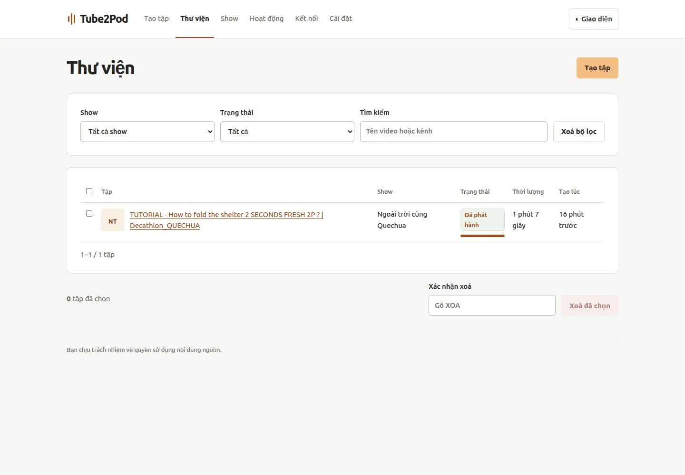
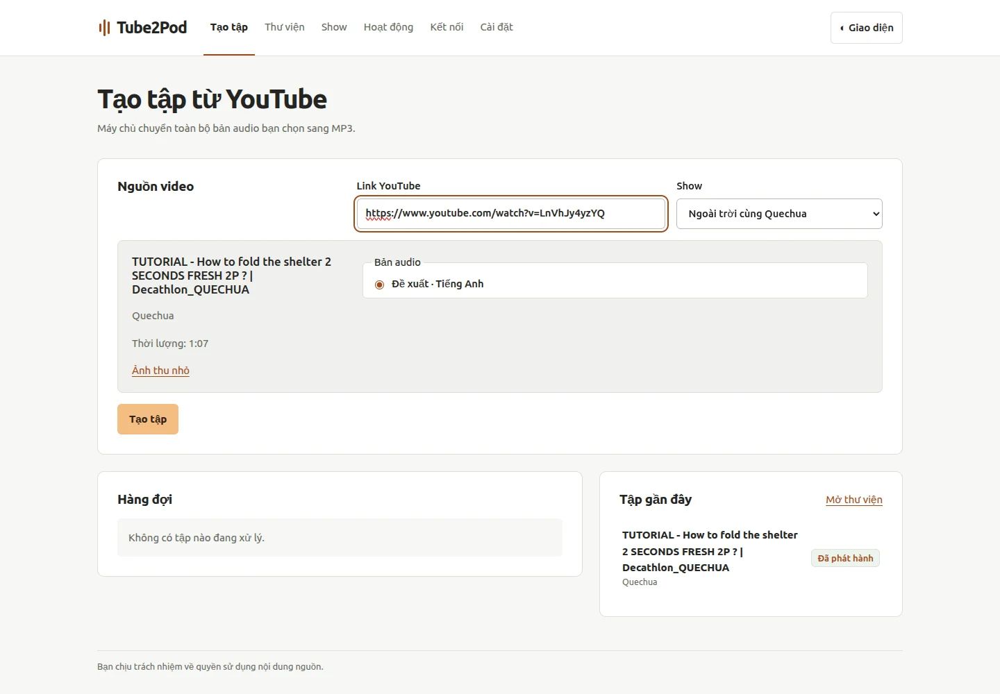
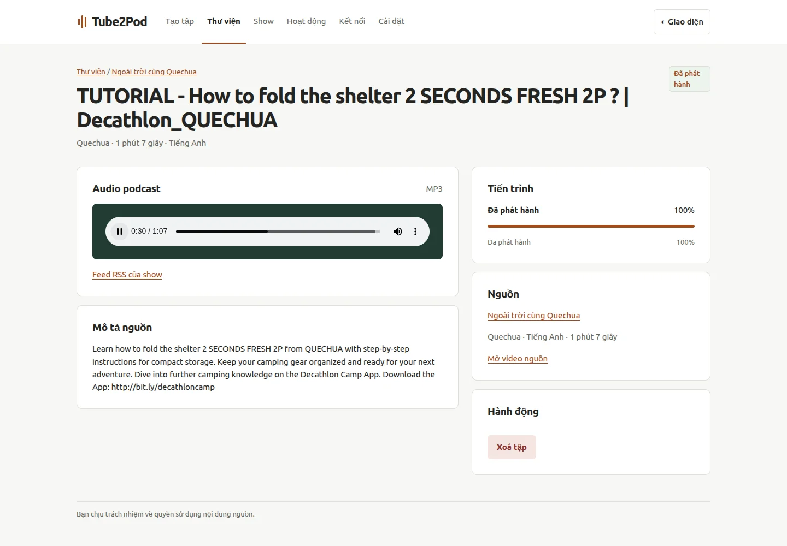
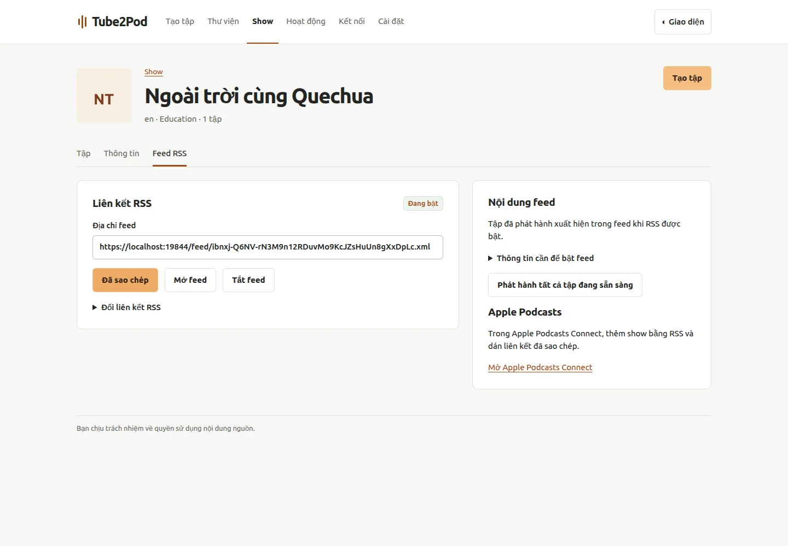

# Tube2Pod

[Tiếng Việt (default)](guide.md) · **English** · [简体中文](guide.zh-CN.md)

Turn YouTube source audio into RSS podcasts, stored and served from your own machine.
Manage shows in a browser and subscribe from a podcast app.
Direct home publishing requires no Tailscale or relay server.



[Overview](#overview) · [Demo](#demo) · [Requirements](#requirements) · [Installation](#installation) · [Usage](#usage) · [HTTPS](#https) · [Operations](#operations) · [Troubleshooting](#troubleshooting) · [Development](#development)

<a id="overview"></a>
## Overview

- Select source audio with `yt-dlp`, convert the full track to MP3 with `ffmpeg`, and measure duration with `ffprobe`.
- Manage shows, episodes, queues, artwork and a separate RSS feed for each show.
- Preview audio, publish episodes and filter the library; light, dark and system themes.
- Pair the mobile app on your LAN using a one-use QR code; administration stays at home.
- Publish directly through Caddy and router NAT; the desktop installer downloads media tools, and Caddy is installed separately.

```text
YouTube → yt-dlp → ffmpeg → MP3 + SQLite on your home machine
Listener → HTTPS/domain → router NAT → Caddy → public :8401
Owner    → http://localhost:8402 → management website
```

### Platforms and verification

| Platform | Intended package | Verified |
| --- | --- | --- |
| Ubuntu Desktop 24.04 x64 | `tube2pod-x86_64-unknown-linux-gnu.deb` | Clean Ubuntu container: GDebi install, tool download, real source/RSS, offline reopen after reinstall |
| Windows x64 | `tube2pod-x86_64-pc-windows-msvc.exe` | Native CI: tool downloads and fixture RSS/MP3 across reinstall passed |
| macOS Apple Silicon | `tube2pod-aarch64-apple-darwin.pkg` | Native CI: tool downloads and fixture RSS/MP3 across reinstall passed |
| macOS Intel | `tube2pod-x86_64-apple-darwin.pkg` | Native CI: tool downloads and fixture RSS/MP3 across reinstall passed |

Local HTTPS, RSS/artwork/MP3, HEAD/Range and admin isolation have been checked. DNS/NAT and podcast playback from outside the home remain unverified.

<a id="demo"></a>
## Chrome demo

Screenshots were captured from the real application with isolated test data on **2026-11-25**, not a mockup. The example uses the [user-provided Quechua video](https://www.youtube.com/watch?v=LnVhJy4yzYQ), processed and published through the real pipeline: **67.05 seconds**, **1,073,709 bytes** of MP3 audio.

Chrome was used to preview the real YouTube source, edit the show, open the library, play the episode, seek to 30 seconds and open the RSS page. Playback continued after seeking without a media error. `localhost:19844` in the screenshots is a local test origin, not a public feed for readers to subscribe to.

| Screen | Action |
| --- | --- |
| Library / Thư viện | Filter by show/status and open a published episode |
| Episode details | Play MP3 and seek using the timeline |
| Feed RSS | View feed status, copy the URL and check publishing requirements |

<details>
<summary>View the preview, player and RSS feed</summary>







</details>

<a id="requirements"></a>
## Requirements

The desktop installer downloads media tools; manual installation below is only for the portable package.

| Component | Needed for | Installation source |
| --- | --- | --- |
| Native Tube2Pod | Always | Build from source or use a successful workflow artifact |
| Standalone `yt-dlp` | Previewing/downloading audio | [Official releases](https://github.com/yt-dlp/yt-dlp#release-files) |
| `ffmpeg` and `ffprobe` | Converting and inspecting MP3 | [FFmpeg Downloads](https://ffmpeg.org/download.html) |
| Caddy | Public HTTPS sharing | [Caddy Install](https://caddyserver.com/docs/install) |
| Public IP and router/NAT access | Listening outside home | Forward TCP 80/443 to Caddy |

Use `yt-dlp_linux` for Linux x64, `yt-dlp_macos` for macOS and `yt-dlp.exe` for Windows. A `pip install --user` entrypoint can lose its Python module because Tube2Pod gives yt-dlp a separate HOME/cache; prefer standalone binaries. Allow enough disk space for audio and keep the machine running while listeners connect. Rust is unnecessary when using a suitable prebuilt package.

<a id="installation"></a>
## Install and run

### Install the desktop app

1. Open [Tube2Pod 0.1.0](https://github.com/nguyentrichanhung/Tube2Pod/releases/tag/v0.1.0) and select the installer for your computer under **Assets**. On a Mac, check the chip under **About This Mac** in the Apple menu.
2. Extract the downloaded archive, open the installer and follow its instructions. Launch **Tube2Pod** from Windows Start, the Ubuntu applications list or macOS Applications.
3. Connect to the Internet and select **Cài đặt** (Install). Tube2Pod downloads yt-dlp, FFmpeg and ffprobe. When setup is ready, select **Mở Tube2Pod** (Open Tube2Pod). Uninstalling and reinstalling preserves your data and settings.

[Installer checks](https://github.com/nguyentrichanhung/Tube2Pod/actions/runs/45599981342) passed on all four targets. Each runner downloaded the tools, converted a sample to MP3 and retrieved the RSS feed and MP3 after reinstall. On a local Ubuntu machine, version 0.1.0 also published a 67-second episode from the sample YouTube video. When GitHub Actions tried the same video, YouTube required yt-dlp to sign in for a bot check during preview. [Diagnostic log](https://github.com/nguyentrichanhung/Tube2Pod/actions/runs/45616026027/job/139211516893)

The Windows and macOS installers are unsigned. The prompts shown when opening a downloaded installer on a personal computer have not been tested.

### Portable package (manual setup)

The steps below apply only to the portable package; the desktop installer downloads the tools during setup.

#### 1. Install media tools

- **Ubuntu/Debian:** `sudo apt install ffmpeg`; download standalone yt-dlp from the source above, put it in your tools directory and run `chmod +x /path/to/yt-dlp_linux`.
- **macOS:** if you use Homebrew, `brew install ffmpeg` supplies ffmpeg/ffprobe; download `yt-dlp_macos` and make it executable.
- **Windows:** extract a Windows build linked from FFmpeg's download page, keeping both `ffmpeg.exe` and `ffprobe.exe`; download `yt-dlp.exe`.

Set absolute tool paths in the config if they are not on PATH. Check `yt-dlp --version`, `ffmpeg -version`, `ffprobe -version`, using the actual installed paths/filenames when different.

#### 2. Obtain and extract a package

Download the matching portable package from [Actions](https://github.com/nguyentrichanhung/Tube2Pod/actions/runs/45599981342) after signing in to GitHub, or [build from source](#development). Extract the entire package into its own directory.

Create a config inside the extracted directory:

```sh
# Linux / macOS
cp portable.env.example tube2pod.env
```

```powershell
# Windows PowerShell
Copy-Item portable.env.example tube2pod.env
```

#### 3. Configure tools and data

Windows example; use equivalent absolute paths on Unix:

```dotenv
YTDLP_PATH=C:\Media Tools\yt-dlp.exe
FFMPEG_PATH=C:\Media Tools\ffmpeg.exe
FFPROBE_PATH=C:\Media Tools\ffprobe.exe
# Optional; keep data outside the package directory
DATA_DIR=C:\Tube2Pod data
# Set only after choosing your HTTPS hostname
# PUBLIC_BASE_URL=https://your-name.duckdns.org
```

The UTF-8 file uses `KEY=VALUE`, allowing BOM/CRLF, blank lines, leading `#` comments and matching outer quotes. It does not expand `$HOME`, `~`, shell commands, escapes or trailing comments. Duplicate keys and malformed lines fail. Precedence: **nonblank environment → file → defaults**. The launcher switches to the package directory; use absolute tool/data paths.

#### 4. Start the server and open the website

```sh
# Linux / macOS, first terminal
./start.sh
# Or: ./start.sh '/path with spaces/settings.env'
```

```powershell
# Windows
.\start.ps1
# Or: .\start.ps1 -Config 'C:\Tube2Pod config\settings.env'
```

If PowerShell blocks scripts, run the binary directly: ` .\tube2pod.exe --config .\tube2pod.env `. No system-wide protection needs to be disabled.

Open **[http://localhost:8402](http://localhost:8402)** on the server machine, or the printed owner URL if the port was changed. Keep the terminal open. **Ctrl+C** stops the server; closing the browser tab does not. Windows/macOS do not automatically run in the background or start at login. Caddy runs separately.

<a id="usage"></a>
## Create and share a podcast

1. Open **Settings / Cài đặt** and enter the owner's name/email and source duration limits.
2. Open **Show**, create a show, fill in its description/language/category and check its artwork.
3. Open **Create episode / Tạo tập**, paste an authorized YouTube URL, select the show, wait for the preview and choose an audio track.
4. Click **Tạo tập** and watch the queue. When **Ready / Sẵn sàng**, open the episode to preview it.
5. Open the show's **Feed RSS** tab, complete its checklist, enable RSS and publish ready episodes. Enabling RSS requires a valid public origin.
6. Copy the **complete feed URL** into your podcast app. For Apple submission, use [Apple Podcasts Connect](https://podcastsconnect.apple.com/).

To pair a phone on the same Wi-Fi, open **Connection / Kết nối → Tạo mã ghép cặp** and scan with Tube2Pod's mobile app. Generate a new QR per device; codes expire and are single-use. Revoke devices on the same page. See the [mobile app README](../apps/mobile/README.md).

<a id="https"></a>
## Home HTTPS and a free hostname

1. Run `whoami`; on Windows use the part after `\`. Sign in to [DuckDNS](https://www.duckdns.org/) and create `<username>.duckdns.org` if valid and available. This is a naming suggestion, not automatic registration.
2. Point it at your home's public IP. When the IP changes, update it using a method you manage; see the [DuckDNS API](https://www.duckdns.org/spec.jsp). Tube2Pod does not update DNS.
3. Set `PUBLIC_BASE_URL=https://your-name.duckdns.org` and restart the server.
4. Copy `Caddyfile.example` to `Caddyfile` (in source: `deploy/Caddyfile.example`) and replace the hostname:

```caddyfile
your-name.duckdns.org {
    reverse_proxy 127.0.0.1:8401
}
```

5. Forward TCP **80/443** to the Caddy machine and allow those ports through its firewall. In a second terminal:

```sh
caddy run --config Caddyfile --adapter caddyfile
```

With correct DNS and reachable ports, Caddy [obtains and renews certificates](https://caddyserver.com/docs/automatic-https). Keep Caddy's data persistent. DNS/certificates are Internet infrastructure; the audio goes directly to your home machine without a relay.

| Default port | Purpose | Scope |
| --- | --- | --- |
| 8400 | Existing admin listener | Loopback |
| 8401 | RSS/audio/artwork/health | Loopback; only Caddy proxies here |
| 8402 | Owner UI | Loopback; manage on the home machine |
| 8403 | Mobile pairing/access | LAN |
| 80/443 | Caddy/HTTPS | Internet NAT |

**Do not forward 8400–8403 to the Internet.** Test the feed, artwork, playback and seeking over 4G/5G. Your home Wi-Fi may lack NAT loopback; localhost checks do not prove Internet access. [Detailed HTTPS guide, Vietnamese](../deploy/direct-https.md).

<a id="operations"></a>
## Operations, backup and upgrades

### Data location

| Run mode | Default DATA_DIR |
| --- | --- |
| Portable Windows | `%LOCALAPPDATA%\Tube2Pod` |
| Portable macOS | `~/Library/Application Support/Tube2Pod` |
| Portable Linux | `$XDG_DATA_HOME/tube2pod` or `~/.local/share/tube2pod` |
| Linux systemd | `/var/lib/tube2pod` |

An explicitly configured DATA_DIR is retained. Portable defaults apply only with `--config`; omitting it keeps the existing environment-based mode.

### Linux systemd

Install tools system-wide: the unit uses `ProtectHome=true`, making tools under `/home` inaccessible. The example expects yt-dlp at `/usr/local/bin/yt-dlp` and ffmpeg/ffprobe in `/usr/bin`. Put binaries there or edit paths in `/etc/tube2pod/tube2pod.env` and rerun the installer.

```sh
# Inside the extracted Linux package; installs and starts the service
sudo deploy/install-linux-x86_64.sh ./tube2pod
sudo systemctl status tube2pod
sudo journalctl -u tube2pod -f
# Stop / restart
sudo systemctl stop tube2pod
sudo systemctl restart tube2pod
```

The installer creates a service account, retains existing config/data, replaces the binary/unit and restarts. Manage Caddy separately.

### Backup and migration

Stop the server and back up the **entire DATA_DIR** plus the config file; use a suitable SQLite online backup when running. Extract an upgrade into another directory and reuse config/data. Do not unintentionally overwrite env files or change tokens/public URLs.

**Upgrading from the old pipeline:** the first run deletes old episodes with no audio-track selection in `queued/running/review`, including related files and previously published audio being reread. Other episodes retain audio/transcripts/summaries/URLs. Test on a copy first; interrupted cleanup can resume after restart.

Cleanup runs at startup and every 24 hours:

- Unreferenced/superseded audio: 7 days by default (`retention_old_audio_days`); every episode's current audio is retained. Versioned files linked to an episode use its `updated_at`; orphan files use mtime.
- Temporary directories for `failed/cancelled/ready/published` episodes and orphan UUIDs: 24 hours by default (`retention_tmp_hours`), based on mtime. Queued/running episodes, `tmp/yt-dlp` and non-UUID directories are skipped. Both retention settings have a minimum of one day/hour respectively.
- Canonical transcripts are not removed by retention. Automatic database backups under `backups/` contain no audio and do not replace full-data backups.

Rotating a token invalidates the old URL immediately. Changing hostnames may break subscriptions; redirect only while you still control the old endpoint. Existing relay installations retain their [deployment guide](../deploy/relay.md).

<details>
<summary>Optional Tailscale for existing installations</summary>

```sh
sudo tailscale serve --bg --https=443 http://127.0.0.1:8400
sudo tailscale funnel --bg --https=8443 http://127.0.0.1:8401
```

Admin stays tailnet-only; Funnel exposes the public listener on 8443. PUBLIC_BASE_URL must match the Funnel origin, including `:8443`, without a trailing slash. Do not expose admin through Funnel. New installations following the Caddy guide do not require Tailscale.

</details>

<a id="troubleshooting"></a>
## Troubleshooting

| Symptom | Check |
| --- | --- |
| Missing media tool / Python module | Use standalone binaries and absolute paths; check executable permissions and version commands |
| ffmpeg cannot find a temporary file | Check permissions/package sandboxing; a Snap build may not see the application's `/tmp` |
| YouTube preview/download fails | Check URL, network and current yt-dlp; upstream sources can time out or become unavailable. Inspect terminal logs; a previous preview does not guarantee a later download |
| Port already in use | Stop the conflicting process or change the matching BIND setting; update Caddy if the public port changes |
| Feed cannot be enabled | Complete the show/owner/artwork checklist and PUBLIC_BASE_URL |
| Feed unreachable outside home | Check DNS, public IP, NAT 80/443, firewall and both processes; test from another network |
| Phone pairing fails | Use the same LAN, allow local port 8403, generate a new QR if used/expired |

<a id="development"></a>
## Development and testing

Use current stable Rust and a native toolchain (Windows: MSVC/C++ Build Tools; macOS: Xcode Command Line Tools; Linux: C compiler/linker). Cargo.toml declares Rust 1.85 as a minimum; the complete lockfile has not been verified on that minimum version.

```sh
cargo build --release --locked --bin tube2pod
cargo test --locked --all-targets
cargo fmt --all -- --check
# Requires real ffmpeg/ffprobe in PATH or *_PATH environment variables
cargo test --locked --bin tube2pod real_media_conversion_with_spaces -- --ignored
```

From the source checkout, copy `deploy/portable.env.example` to your own config, then run `cargo run --locked --bin tube2pod -- --config /path/to/tube2pod.env`. Building produces a binary, not an archive:

```sh
# Run on Linux x64; macOS uses its matching native target
./deploy/package.sh x86_64-unknown-linux-gnu target/release/tube2pod dist
```

```powershell
# Run on Windows x64
.\deploy\package.ps1 -Target x86_64-pc-windows-msvc -Binary target/release/tube2pod.exe -OutDir dist
```

The workflow tests four native targets, including installation, tool downloads and RSS/MP3 retrieval after reinstall. When running it manually, enter an authorized YouTube video in `youtube_url` to also test preview through publication.

## Contributing and license

For bug reports, include OS/architecture, launch method, tool versions, reproduction steps and logs with secrets removed. Do not post pairing credentials, keys or private data. Run relevant tests for code changes and describe their results in your PR.

Source code is licensed under [Apache License 2.0](../LICENSE). Download and distribute only content you have permission to use.
